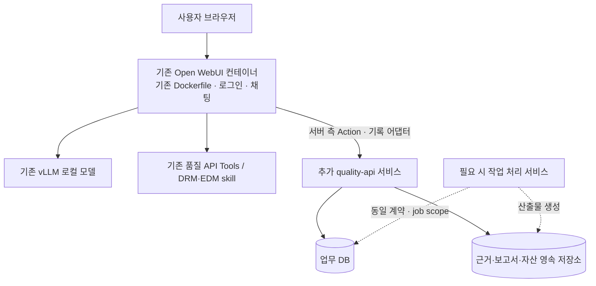

# 품질팀 에이전트 — Dockerfile 기반 별도 서비스 배포 가이드

> **현재 구현 확인**: 이 문서는 설계 기준이다. 현재 코드의 동작·제한은 [구현 상태](./implementation_status.md), 실행 방법은 [운영 배포 문서](./deployment.md), 실제 요청 DTO는 [OpenAPI](./openapi.json)를 우선 대조한다.

> 버전 1.0 / 2026-11-10. [구현 가이드](./quality_agent_implementation_guide.md)의 배포 보완 명세다.
> **사용자 확인**: Open WebUI는 Dockerfile로 배포 중이며, 품질 업무 API를 별도 컨테이너/서비스로 추가 배포할 수 있다.
> **선택한 기본 구성**: 기존 Open WebUI + 별도 `quality-api` + 업무 저장소. 필요할 때만 작업 처리 서비스를 추가한다.
> **미확인**: 실제 Dockerfile 전문·기동 명령·서비스 주소·인증 위임·DB/볼륨·배포 플랫폼 설정. 아래 이름·포트는 제안하는 논리 계약이며 실제 사내 주소가 아니다.
> **산출물 상태**: 배포 지침이다. 현재 이미지·애플리케이션·배포 명세를 생성하거나 실제 환경에 배포했다는 뜻이 아니다.

## D1. 서비스 배치

| 구성 | 이번 작업 |
|---|---|
| 기존 Open WebUI | 검증된 Tool wrapper·Action 등록, 업무 API 주소·인증 연결 설정 |
| 기존 vLLM·품질 Tools | 현재 실행 경로 유지, 필요한 수집 연결만 적용 |
| quality-api | 케이스·근거·결과·자산·권한·claim 처리. 별도 Dockerfile/이미지로 배포 |
| 업무 DB | 기존 승인된 DB에 전용 database/schema·계정을 두는 방식을 우선 검토. 없으면 운영 가능한 DB 확보 |
| artifact 저장소 | 승인된 객체 저장소 또는 영구 볼륨. 이미지/컨테이너 삭제와 독립 |
| worker — 기능별 선택 | 비동기 보고서·검증·동기화 기능에 필요할 때 같은 코드 이미지의 별도 실행 모드로 배포 |

업무 DB를 Open WebUI 내부 테이블에 직접 추가하거나 Open WebUI DB 마이그레이션으로 관리하지 않는다. 같은 DB 서버를 사용하더라도 스키마·계정·마이그레이션 범위를 분리한다. 같은 Open WebUI 컨테이너에 업무 API를 함께 기동하는 구성은 이번 기본안으로 사용하지 않는다.

## D2. Dockerfile과 실행 설정의 책임

Dockerfile은 코드·의존성·기본 실행 명령을 이미지에 넣는다. 서비스 실행, 네트워크, 비밀값, 영구 저장소 연결, healthcheck, 복제 수는 사내 플랫폼의 배포 설정에서 정한다. Docker Compose 사용이 필수는 아니다.

### D2.1 기존 Open WebUI 이미지

- 기존 베이스 이미지·인증·vLLM 연결·기동 CMD/ENTRYPOINT·백업 흐름을 먼저 확인한다.
- 새 Tool wrapper가 추가 패키지를 요구하면 승인된 버전을 빌드 시 포함하고 기존 패키지와의 충돌을 검증한다. 실행 시 매번 최신 패키지를 설치하지 않는다.
- Open WebUI가 별도 업무 API를 호출하도록 설정한다. API 장애가 Open WebUI 프로세스 기동 실패나 일반 대화 중단으로 전파되지 않게 한다.
- Function/Tool 코드를 이미지에 COPY한 것만으로 등록되었다고 간주하지 않는다. 설치 버전에서 지원되는 관리자 등록/가져오기/API 경로를 사용하고 등록 ID·버전을 기록한다.
- Functions는 DB에 저장되는 플러그인이므로 이미지 파일과 등록된 버전을 대조한다. Open WebUI DB에 SQL을 직접 써서 등록하지 않는다. [Functions 공식 문서](https://docs.openwebui.com/features/extensibility/plugin/functions/)

### D2.2 새 업무 API 이미지

업무 API용 Dockerfile은 기존 Open WebUI Dockerfile과 별도 파일이다. 회사에서 승인된 실행 이미지와 실제 프로젝트의 고정 의존성을 사용한다. vLLM 서버·모델 가중치·기존 Open WebUI 전체 소스를 복사하지 않는다.

운영 사용자 권한, 코드 복사 위치, 쓰기 허용 경로, 실제 모듈의 실행 명령, graceful shutdown을 정의한다. 아직 없는 `app.main` 같은 모듈이 작동한다고 가정하지 않는다. `.dockerignore`에서 실제 비밀값·로컬 DB·원천 자료·불필요한 개발 산출물을 제외한다. 인증값을 Dockerfile ENV/ARG/RUN/COPY로 이미지에 넣지 않는다.

M1 시작은 quality-api **1 replica**로 검증한다. 실제 업무 DB 엔진에서 claim·멱등성·잠금을 검증한 뒤 확장 여부를 결정한다. worker가 필요한 경우 job을 DB에 기록하고 lease·재시작 복구를 구현한다. API의 메모리 목록이나 응답 후 임시 background task만으로 비동기 작업 영속성을 주장하지 않는다.

## D3. 서비스 주소·네트워크·UI 접근

`QUALITY_API_BASE_URL`은 새로 구현하는 Open WebUI 연결 코드의 설정 이름이다. Open WebUI 기본 내장 환경변수라고 가정하지 않는다. 이번 코드의 값은 실제 플랫폼에서 확인한 업무 API origin(프록시 앞쪽 경로가 있으면 포함)이다. bridge가 `/quality/v1`을 붙인다. 이전 설정의 정확한 `/quality/v1` 접미사는 정규화하며 경로를 두 번 붙이지 않는다.

같은 로컬 Compose 네트워크의 설정 예시는 `http://quality-api:8000`이며 실제 업무 요청은 `/quality/v1` 아래로 전송한다. 이는 검증용 예시이며 사내 배포 주소가 아니다. 별도 컨테이너의 `localhost`는 그 컨테이너 자신을 가리키므로 업무 API 주소로 사용하지 않는다. Compose에서는 동일 네트워크의 서비스명으로 연결할 수 있지만 사내 플랫폼에서는 제공되는 서비스 주소·포트·라우팅을 확인한다. [Docker 네트워킹](https://docs.docker.com/compose/how-tos/networking/)

업무 API는 컨테이너 간 접속 가능한 listen interface와 실제 서비스 target port를 사용한다. 예를 들어 컨테이너 내부 `0.0.0.0:8000`으로 기동하고 플랫폼의 내부 서비스에 연결할 수 있으며, 실제 포트는 배포 환경에 맞게 확정한다. 이것이 인터넷 공개나 인증 생략을 뜻하지 않는다.

| 통신 | 필요한 연결 |
|---|---|
| Open WebUI 서버 → quality-api | claim·기록·케이스·Action 요청. 인증된 서버 간 연결 |
| quality-api → 업무 DB/artifact 저장소 | 상태·파일 저장과 조회. 업무 전용 권한 |
| quality-api → 인증 검증 경로 | 현재 인증 방식의 issuer/key/검증 서비스. 임의 주소 추정 금지 |
| quality-api/worker → vLLM | 분리된 근거 정리 작업을 구현하는 경우에만 기존 승인 연결 활용 |
| worker → artifact 저장소 | 고정 snapshot 기반 산출물 저장 |
| 사용자 → 결과 다운로드/업무 화면 | 사용자 인증과 case·원천 ACL을 검사하는 실제 접근 가능한 경로 |

브라우저/Rich UI에 내부 서비스 주소가 자동으로 접근 가능하다고 가정하지 않는다. 초기 Action은 Open WebUI 서버가 업무 API를 호출하는 방식으로 연결한다. 산출물은 검증된 Open WebUI 파일 전달 경로 또는 별도의 인증된 업무 경로로 제공한다. 내부 DB 포트·artifact 디렉터리·서버 API 자격을 브라우저에 공개하지 않는다. 별도 업무 화면이 필요한 경우에만 사용자 접근 라우트·SSO·CSRF/CORS 정책을 추가한다.

TLS·사내 CA·프록시 우회 설정은 현재 플랫폼에 맞게 확인한다. 연결이 안 된다는 이유로 인증서 검증을 끄거나 모든 CORS origin을 허용하지 않는다. 실제 내부 주소를 문서 예시나 코드에 추측해서 넣지 않는다.

## D4. 서버 간 인증과 역할 분리

계약 C2의 human/model_delegate/trace_adapter/worker 권한은 컨테이너를 나누어도 그대로 유지한다.

1. Open WebUI의 검증된 사용자 맥락을 실제 지원 경로에서 얻는다.
2. 업무 API가 검증할 수 있는 기존 사내 인증 또는 신뢰된 서버 위임으로 전달한다.
3. 사용자·case/run·행위·만료·audience를 검증하고 역할별 허용 endpoint를 적용한다.
4. 모델 제안과 기록 어댑터가 사람 승인 권한을 공유하지 않게 한다.

단순 `X-User-Id`나 `kind=human` 헤더를 신뢰하지 않는다. Open WebUI 세션 토큰·SSO 토큰을 업무 API가 그대로 검증할 수 있는지도 확인해야 한다. 맞지 않으면 검증된 위임 어댑터를 사용하고 자체 암호 프로토콜을 발명하지 않는다.

비밀값은 플랫폼의 runtime secret/환경변수/secret file로 주입한다. 역할별 범위를 지키고, 관리자 토큰 하나를 모든 Tools·Action·worker에 공유하지 않는다. UI·모델 입력·로그·health 응답에 비밀값을 넣지 않는다. M0에서 인증이 확인되지 않으면 실제 관리 기능을 켜지 않으며 fake 인증은 mock에서만 허용한다.

## D5. 저장소·버전·백업

### D5.1 저장 대상

| 데이터 | 주 저장소 | 배포 시 확인 |
|---|---|---|
| 기존 Open WebUI 사용자·채팅·등록 Functions/Tools | 현재 Open WebUI 저장·백업 | 기존 방식 유지, 등록 버전과 이미지 의존성 일치 |
| case/run/call/claim/review/snapshot/asset 상태 | 업무 DB | 컨테이너 교체 후 유지, unique·FK·transaction 보장 |
| 근거 원문·변환 파일·보고서·버전 자산 | 객체 저장소 또는 영구 볼륨 | 원천 보존 정책, 권한, 불변 object key/hash, 누락 파일 검출 |
| 호출 성공 후 아직 전달하지 못한 outcome/outbox | 실제 기록 어댑터가 사용하는 안전한 영속 영역 | Open WebUI 쪽이면 그 쪽 저장소도 별도 영속·복구 대상 |
| 임시 파싱·렌더링 파일 | 제한된 임시 영역 | 삭제 가능하며 원본·확정 결과의 유일한 사본이 아니어야 함 |

컨테이너 writable layer나 이미지 안에 생성한 파일을 영속 저장소로 취급하지 않는다. 영구 볼륨은 컨테이너 수명과 별개로 유지되도록 배포 설정에서 연결해야 한다. [Docker 볼륨 문서](https://docs.docker.com/engine/storage/volumes/)

API·worker·여러 replica가 같은 artifact를 읽고 쓸 경우 실제로 같은 객체 저장소나 공유 볼륨을 사용하는지 검증한다. 서로 다른 노드의 같은 파일 경로 또는 같은 이름의 로컬 volume은 같은 저장소라는 뜻이 아니다. 공유를 보장할 수 없는 로컬 저장 방식은 단일 배치로 제한하고 별도 worker/다중 노드 확장을 켜지 않는다.

현재 로컬 폴더의 S3 백업 자료가 실제 배포에도 적용되어 있다면, 그 Open WebUI DB 백업만으로 새 업무 DB·artifact·outbox가 백업된다고 가정하지 않는다. 객체 저장소의 스냅샷 백업은 온라인 DB의 transaction·locking이나 마지막 성공 백업 이후 데이터의 보존을 대신하지 않는다.

### D5.2 데이터 일관성

artifact는 고정 ID/version/hash로 저장하고 존재·무결성을 확인한 뒤 DB에서 available로 공개한다. DB와 파일 저장이 한 transaction이라고 가정하지 않는다. pending/failed 상태와 재시도·대조를 둔다. worker가 파일을 아직 완성하지 않았는데 정상 다운로드 URL을 반환하지 않는다.

백업에는 업무 DB 백업 식별자·스키마 버전·artifact ID/version/hash 목록·필요 outbox 상태를 연결한 manifest를 남긴다. 원문 보존 정책을 벗어나는 자료를 백업에 추가하지 않는다. 복원 시 참조가 없는 파일/파일이 없는 참조를 탐지하고 검토 상태를 숨기지 않는다. RPO·RTO·보존 기간은 파일럿 전에 확정한다.

## D6. 기동·마이그레이션·상태 확인

### D6.1 순서

1. 업무 DB·artifact 저장소·runtime secrets를 준비한다.
2. 배포 버전에 맞는 업무 DB 마이그레이션을 **한 번만** 실행한다. 동시 마이그레이션을 막는 잠금/배포 job을 사용한다.
3. quality-api를 시작하고 schema 호환성·저장소·인증 설정을 검사한다.
4. 필요할 때만 worker를 시작하고 지정된 job lease·권한을 검사한다.
5. Open WebUI 연결 설정·확장 등록을 확인하되 관리 기능은 비활성 상태로 smoke test한다.
6. 검증 통과 후 선정 사용자·업무에서 관리 기능을 켠다. 일반 대화 기준선을 다시 확인한다.

Open WebUI DB를 업무 migration 대상으로 사용하지 않는다. API replica마다 기동 때 경쟁적으로 schema를 변경하지 않는다. 이미지 rollback이 DB schema rollback을 뜻하지 않으므로 호환되는 이전 이미지 범위와 복구 계획을 기록한다.

### D6.2 새 업무 API의 상태 확인 계약

아래 endpoint는 앞으로 구현할 quality-api의 운영 경로다. 기존 Open WebUI 경로가 아니다.

| 경로 | 200 조건 | 실패 시 |
|---|---|---|
| `GET /health/live` | 프로세스가 응답 가능 | 응답 실패/비정상 종료를 플랫폼이 탐지 |
| `GET /health/ready` | 필수 설정·지원 DB schema·DB 연결·필수 artifact 경로·인증 검증 설정이 준비됨 | 503, 라우팅 제외 |

응답은 상태·버전·제한된 오류 코드만 포함한다. 원문·DSN·키·내부 주소를 반환하지 않는다. 인증 설정·유효한 검증 키 상태를 확인하되 health 요청마다 원천 Tool·LLM·원천 쓰기를 실행하지 않는다. 외부 모델 장애 때문에 DB/API 프로세스를 무한 재시작시키지 않는다.

container running과 ready는 다르다. Compose를 사용한다면 healthcheck와 조건부 의존성을 적용하고, 사내 플랫폼에서는 대응하는 readiness/startup 설정을 사용한다. [Docker 기동 순서](https://docs.docker.com/compose/how-tos/startup-order/)

## D7. 배포·종료·장애·복원

### D7.1 정상 업데이트

관리 기능의 신규 접수를 중지하고, 신규 run/claim을 차단한다. 기존 outcome/close·outbox 기록과 읽기 전용 조회는 종료 유예 동안 허용한다. 완료되지 않은 원천 호출을 임의 성공/취소로 바꾸지 않는다. 작업 상태와 결과를 저장한 뒤 종료하고 새 이미지에서 다시 상태를 조회한다.

플랫폼 readiness/라우팅 전환이 기존 outcome 저장 경로까지 먼저 끊지 않도록 drain 순서를 검증한다. 새 healthy 인스턴스로 기록을 전달하거나 기존 기록 경로를 종료 유예 동안 유지한다. 모든 인스턴스가 내려간 기간에는 기록 outbox가 실제로 영속화되는지 확인한다.

기동 직후 이전 claimed 호출을 원천에 다시 실행하지 않는다. lease 만료나 프로세스 교체는 새 실행권 부여 근거가 아니다. claim 응답의 execute=true/token을 캐시 재생하지 않는 C3/C4 규칙은 프록시·재시도 계층에도 적용한다. 프록시가 임의로 변경 요청을 재실행하지 않게 한다.

rolling 배포는 신·구 API·플러그인·schema 호환성과 공유 DB·artifact·job claim이 검증된 뒤 사용한다. 검증 전에는 관리 기능을 잠시 중지한 순차 교체를 기본으로 한다. 기존 Open WebUI 배포가 순차 교체/별도 백업 순서를 요구한다면 그 조건도 유지한다.

### D7.2 업무 API 장애

일반 대화는 기존 모델·Tools로 계속 동작한다. 관리 케이스에서 호출 전 claim이 불가능하면 원천 호출을 막고 연결 오류를 표시한다. 원천 성공 후 API 장애면 결과 기록만 복구 대상으로 두고 원천을 반복 실행하지 않는다. 복구 가능한 안전한 사본이 없으면 trace_incomplete/unavailable을 표시한다.

업무 API를 잠시 끄는 것과 기존 에이전트 전체를 끄는 것을 구분한다. 확장 feature flag는 일반 채팅 설정을 덮어쓰지 않는다. 보고서 재처리는 고정 snapshot만 사용하고 원천 Tool을 다시 호출하지 않는다.

### D7.3 백업 복원

복원한 환경은 관리 기능·원천 실행·자동 job dispatch를 차단한 격리 상태로 시작한다. DB와 artifact manifest를 대조하고 참조·권한·버전·outbox·claimed/unknown 상태를 확인한다. 백업 이후 실행은 ledger에서 사라졌을 수 있으므로 원천 요청 기록과 대조한다. 복원된 DB만으로 중복 방지가 완전하다고 주장하지 않는다.

복원 이전의 미소비 승인·claim token·대기 실행 요청을 자동 재사용하지 않는다. **복구 세대(epoch) 또는 동등한 재전송 차단 수단을 필수로 적용**한다. 복원 DB 밖의 배포 설정에서 새 세대를 발급하고 신뢰된 dispatch 문맥에 바인딩한다. request_id/invocation_id가 복원 DB에서 사라졌더라도 과거 세대 요청을 새 실행으로 받아들이지 않는다.

Open WebUI 연결부는 재전송 요청의 원래 세대를 유지하고 오래된 요청에 현재 세대를 붙여 다시 보내지 않는다. 복원 후 이전 대기·자동 재시도는 중단/검토 필요로 표시하며 사용자에게 새 요청 시작을 요구한다. 구분할 수 없는 연결 경로는 다시 검증할 때까지 관리 실행을 막는다. 단순 토큰 키 회전만으로 과거 본문의 재전송까지 막았다고 주장하지 않는다.

확인되지 않은 실행은 unknown으로 남기고, 누락 기록 보완은 별도 인증·원천 증빙 검사 경로로만 허용한다. 검토 완료 후 신규 요청만 다시 접수하며, 이후 원천 쓰기를 도입한 경우에는 재확인 정책까지 적용한다. 진단·인증된 상태 조회와 기록 대조 경로는 복구 중에도 제한적으로 사용할 수 있게 한다.

## D8. 설정·배포 산출물

| 항목 | 확정할 내용 |
|---|---|
| 품질 API 이미지 | 별도 Dockerfile 경로, 승인된 base/version, 빌드 산출 image digest |
| API 실행 | 실제 entrypoint, listen port, API prefix, replica 수, 종료 유예 |
| 서버 간 연결 | 실제 QUALITY_API_BASE_URL, 네트워크·TLS·CA·proxy 설정 |
| 인증 | 검증 방식, issuer/audience 또는 위임 어댑터, 역할별 secret 참조 |
| 저장 | 업무 DB 참조, artifact 저장 방식·경로, outbox 위치와 영속성 |
| 배포 작업 | migration job, live/ready probe, 기능 활성화·비활성화 방법 |
| 복구 | 백업 manifest, 복원 격리, 실행 대조, schema/image rollback 범위 |

위의 이름은 구현할 설정 항목이다. 실제 환경변수 키는 코드·플랫폼에서 하나로 정해 환경표에 기록한다. 동일 설정이 DB/Valves/환경변수에 중복되면 우선순위와 실제 적용값을 명시하되 비밀값은 출력하지 않는다.

배포 코드 작성 단계의 산출물은 `Dockerfile.quality-api`, 의존성 lock, `.dockerignore`, 플랫폼용 서비스 명세, migration 실행 방식, 환경변수 이름만 있는 예시, healthcheck, backup/restore runbook, Open WebUI 확장 등록·버전 절차다. 이 파일들이 현재 이미 존재한다고 가정하지 않는다. 실제 앱 코드가 없는 이미지나 미확인 베이스 이미지로 실행 가능한 배포 예시를 꾸미지 않는다.

## D9. 배포 완료 판정

검증 가이드 T-48~55를 실제 배포 경로에서 수행한다. 먼저 테스트 환경에서 확인하고 증거와 버전을 남긴다.

- 독립 업무 API가 준비되고 Open WebUI 서버에서 인증된 요청이 도달한다.
- quality-api를 중단해도 일반 대화가 동작하고, 관리 케이스는 claim 전에 안전하게 실패한다.
- 컨테이너 교체 후 case·review·snapshot·artifact·등록 확장이 보존된다.
- 다른 사용자·모델 권한으로 승인·기록을 위조하지 못한다.
- drain·재기동·프록시 재전송이 원천 호출을 중복 실행하지 않는다.
- 백업 복원은 격리·대조를 거쳐야 하며 과거 승인이나 claim을 자동 실행하지 않는다.

로컬 Compose나 fake 환경 통과는 사내 플랫폼 통과와 구분한다. 기존 Open WebUI Dockerfile·vLLM·원천 Tools의 정상 동작도 함께 회귀 검증한다.
