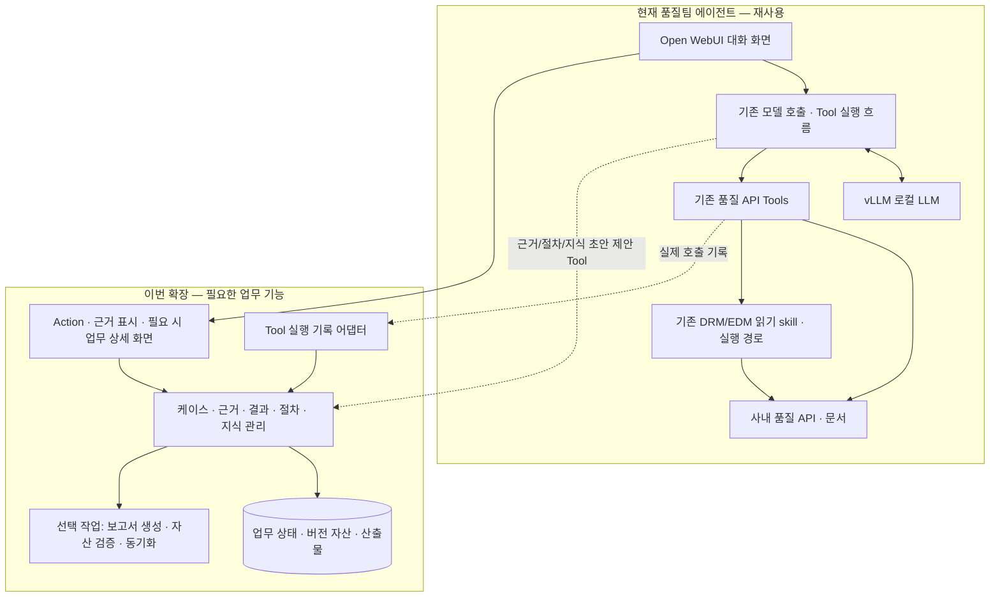

# 품질팀 에이전트 기능 확장 — PRD / FRD

## Open WebUI · vLLM · 기존 품질 API Tools 기반 / T-RAX 핵심 기능 벤치마킹

> **문서 버전**: 품질 업무판 v1.3 | **작성일**: 2026-11-10 | **상태**: 구현 기준 및 로컬 검증, 사내 실환경 연동 검증 전
> **목적**: 이미 구축 중인 품질팀 에이전트에 T-RAX의 케이스 관리·근거 검토·절차 재사용·지식 축적 및 공유 기능을 추가한다.
> **현재 기반 — 사용자 확인**: Open WebUI, vLLM으로 서빙하는 로컬 LLM, 이미 연결된 여러 품질 업무 API Tools, 기존 DRM·EDM 읽기 skill. Functions와 Tools를 사용할 수 있으며 Open WebUI는 현재 `latest` 이미지를 사용한다.
> **배포 — 사용자 확인**: 기존 Open WebUI는 Dockerfile로 배포하며 추가 서비스 배포가 가능하다. 품질 업무 API는 별도 컨테이너/서비스로 배포하는 구성을 기본으로 한다.
> **벤치마킹 범위**: T-RAX에서 전달받은 핵심 기능과 업무 방식을 품질 업무 전반에 맞게 적용한다. 반도체 Test 데이터·판정 기준·구현 기술을 제품의 필수 전제로 삼지 않는다.
> **최종 문서**: 이 파일이 유일한 최종 PRD/FRD다. 과거 버전은 사용자 요청으로 삭제했다. 구현 범위·실제 검증 결과는 [구현 상태](./docs/implementation_status.md), 실행 방법은 [README](./README.md)를 함께 확인한다.
> **검증 범위**: T-RAX 기능은 전달받은 자료를 기반으로 한 BM 대상이다. 실제 T-RAX 구현, 현재 Tool 목록·소스·권한, 모델 성능, 배포 버전은 이 문서 작성에서 직접 검증하지 않았다. 아래 품질 업무와 API 예시는 설계용이며 실제 사내 명칭으로 확정한 것이 아니다.
> **코드 작성 시작점**: [구현 가이드](./docs/quality_agent_implementation_guide.md) → [계약 명세](./docs/quality_agent_contracts.md) → [검증 가이드](./docs/quality_agent_validation.md). 제품 범위는 본 문서, 필드·상태·API 규칙은 계약 명세를 기준으로 한다. 충돌을 발견하면 임의로 해석하지 말고 해당 항목을 표시한다.
> **v1.1 보완**: M0의 Tool 유형별 검증, 로컬 모델 실패 시 보조/수동 모드, 원천 쓰기 실행 승인, 공수 구간, 실행 전 중복 방지·기록 권한을 구체화했다.
> **v1.3 구현**: 별도 업무 API, PostgreSQL, 검토 화면, Open WebUI bridge, 절차·지식 관리, Markdown/DOCX 보고, Docker 배포 코드를 추가했다. 아래 요구사항 전체를 구현 완료했다는 의미는 아니며 기능별 상태는 구현 상태 문서를 따른다.
> **v1.2 보완**: [별도 서비스 배포 가이드](./docs/quality_agent_deployment.md)를 추가했다. 기존 Open WebUI 기동 흐름, 서버 간 인증, 업무 저장소, migration·상태 확인·복구를 구분한다.

---

## Part 1. PRD — 제품 요구사항

### 1.1 제품 정의

**기존 Open WebUI 기반 품질팀 에이전트의 대화·모델·API Tools를 활용하여, 다양한 품질 업무의 수행 과정과 결과를 케이스·근거·절차·지식으로 관리하고 재사용하는 기능 확장 프로젝트.**

현재 사용자는 Open WebUI에서 로컬 LLM과 품질 API Tools를 연결해 품질팀 특화 에이전트를 만들고 있다. 이번 프로젝트는 이 기반에 업무 건별 관리, 출처가 있는 결과 검토, 반복 업무의 절차화, 개인·팀 지식 축적 기능을 얹는다.

기본 실행은 기존 Open WebUI의 모델 호출·Tool 사용 경로를 유지한다. 추가 업무 저장 서비스는 케이스 상태·근거·사용자 결정·자산 버전을 관리한다. `opencode serve` 등 외부 에이전트 엔진은 실제로 필요한 실행 능력이 기존 구성에서 부족한 경우에 검토하는 선택지다.

### 1.2 현재 확보 자산과 추가 범위

| 구분 | 현재 확보된 기반 | 이번 프로젝트의 추가 작업 |
|---|---|---|
| 사용자 접점 | Open WebUI 채팅·모델 선택·첨부 | 케이스 시작, 근거 검토, 절차화·지식 저장 조작 |
| 모델 | vLLM으로 서빙되는 로컬 LLM | 새 기능의 Tool 스키마·지침·출력 형식에 대한 실제 모델 검증 |
| 업무 데이터 | 여러 품질 API가 이미 Tools로 연결됨 | 기존 호출 결과에 업무 식별자·출처·실행 기록 연결 |
| 문서 접근 | DRM·EDM 읽기 skill 작성 완료 | 필요 시 기존 실행 경로와 케이스를 연결하는 어댑터 |
| 업무 기록 | 현재 채팅·도구 결과 활용 | 케이스 상태, 근거 버전, 검토·완료 기록과 산출물 연결 |
| 재사용 자산 | 현재 보유한 지침·Tools·skill | 대화에서 절차 초안 생성, 검증·등록·재사용 |
| 팀 지식 | 기존 문서·지식 기능이 있다면 유지 | 저장 제안·승인·공유·큐레이션·만료 관리 |

기존 Tools가 Workspace Python Tool, 외부 OpenAPI, MCP 중 어떤 형태인지와 DRM·EDM skill의 실제 연결 상태는 M0에서 목록화한다. 재사용 가능한 기존 코드·인증 설정을 우선하며 모든 Tool의 재작성이나 프로토콜 전환을 요구하지 않는다.

### 1.3 해결할 문제

- 업무 자료를 조회하고 답변을 얻어도, 어떤 건의 어떤 결과인지 대화 밖에서 관리하기 어렵다.
- API 결과·문서·사용자 제공 정보와 모델 해석이 섞여 판단 근거를 다시 찾기 어렵다.
- 유사 업무에서 같은 조회 조건과 처리 순서를 반복해서 설명해야 한다.
- 업무 중 발견한 지식과 요령이 개별 대화에 머물러 팀이 재사용하기 어렵다.
- 보고·공유 자료를 만들 때 이미 확인한 사실과 수치를 다시 옮겨 적어야 한다.

### 1.4 T-RAX에서 벤치마킹할 핵심

| BM 기능 | 품질 업무에서 제공할 가치 | 적용 원칙 |
|---|---|---|
| 자유 분석 / 등록 절차 실행 | 새로운 문제 탐색과 반복 업무의 재사용 | 기존 대화·Tool 실행에 절차 선택을 추가 |
| 케이스 관리 | 업무 건별 자료·진행·결과 정리 | 일반 질문과 관리 대상 업무를 구분 |
| 근거 카드와 채택/검토필요 | 출처와 해석을 나눠 확인 | 수치뿐 아니라 문서 조항·표·텍스트 비교도 근거로 지원 |
| 권장 판단과 사람의 확정 | 기준이 있는 업무의 검토 지원 | 해당 업무에서만 켜는 선택 기능 |
| 결과 정리·보고서 생성 | 검토한 내용을 재전사 없이 활용 | 업무별 요약·표·문서 양식을 선택 |
| 절차로 만들기 | 성공한 작업의 입력·Tool 사용·처리 순서 재사용 | 지침형과 검증 실행형을 구분 |
| 지식 저장 제안 | 새 사실·업무 요령을 개인 자산으로 보존 | 사용자가 저장을 승인한 뒤 검색에 활용 |
| 공유·중앙 큐레이션 | 팀 지식의 중복·품질·유효기간 관리 | 공유 권한과 검토 이력 유지 |
| 지식인터뷰·문서보완 | 전문가 지식과 기존 자료 개선 | 같은 제안·승인 흐름으로 연결 |

T-RAX의 화면 구성은 참고자료이며 동일한 메뉴나 UI를 복제할 필요는 없다. 원 시스템의 특정 판정 명칭·임계값·테이블·모델·실행 엔진을 품질 업무의 공통 규칙으로 옮기지 않는다.

### 1.5 사용자와 업무 예시

| 사용자 | 주요 목적 |
|---|---|
| 품질 업무 담당자 | 자료 조회·비교·분석·정리, 반복 업무 수행, 결과 보존 |
| 검토자 / 업무 책임자 | 근거와 결과 검토, 필요한 업무의 판단·문서 승인 |
| 업무 전문가 | 절차 검증, 용어·기준·처리 요령 제공 |
| 지식 운영자 | 공유 자산 검토·분류·병합·게시·만료 관리 |
| 에이전트 운영자 | 기존 모델·Tools와 확장 기능의 연결·버전·운영 관리 |

아래는 품질 업무 전반을 설명하기 위한 활용 예시이며 실제 첫 적용 업무는 기존 Tools와 자료를 확인해 선정한다.

| 업무 예시 | 에이전트 지원 | 선택 산출물 / 판단 |
|---|---|---|
| 품질 이슈 조사 | 이력·관련 문서 조회, 유사 사례·원인 후보 정리 | 근거 목록, 조사 요약, 필요 시 검토 의견 |
| 기준·절차서 개정 검토 | 문서 버전별 변경사항과 영향 항목 비교 | 변경 비교표. 정량 판정 불필요 |
| 고객 요청·불만 대응 준비 | 관련 이력·사실·조치 자료 취합 | 답변 초안. 실제 발송은 별도 업무 절차 |
| 점검·심사 준비 | 체크리스트와 증빙 문서 대응, 누락 자료 확인 | 증빙 목록·미비 항목. 필요 시 사람의 검토 |
| 정기 품질 현황 정리 | 기존 API로 지표 취합·집계·시각화 | 표·차트·정기 보고서 |
| 변경 영향 검토 | 관련 기준·이력·대상 목록 조회 | 영향 검토 메모 또는 업무별 판단 |
| 업무 지식 질의 | 용어·규정·업무 요령 조회 | 출처가 있는 답변. 케이스 생성 불필요 |

### 1.6 목표 / 범위 밖

| ID | 목표 |
|---|---|
| G1 | 기존 품질팀 에이전트의 사용성과 정상 동작을 유지하면서 T-RAX 핵심 기능을 추가한다. |
| G2 | 관리가 필요한 업무를 케이스로 보존하고 조회·계산·해석·검토의 출처를 추적한다. |
| G3 | 반복 업무를 절차로 만들어 다른 입력과 사용자에게 재사용한다. |
| G4 | 지식의 제안·개인 저장·공유·큐레이션을 연결한다. |
| G5 | 업무별로 필요한 검토·판단·문서 생성 흐름을 구성한다. |
| G6 | 재전사와 반복 설명을 줄이고 업무 결과의 검토 가능성을 높인다. |

초기 범위 밖은 전체 채팅 UI 재개발, 로컬 LLM 서빙 교체, 전체 Tools 재작성, DRM·EDM 읽기 기능 재개발, 특정 외부 에이전트 엔진 도입, 모든 품질 업무의 동시 자동화다. 새로운 대외 발송·원천 시스템 쓰기·자동 업무 확정 기능도 이번 확장의 기본 범위에 포함하지 않는다. **M1 관리 케이스는 원천 읽기 전용**으로 시작한다. 케이스·근거·사용자 검토 기록을 업무 DB에 저장하는 것은 원천 시스템 쓰기와 구분한다. 기존 일반 대화의 정책은 유지하되, 관리 케이스에서 원천 쓰기를 허용하려면 §3.10의 실행 전 승인 검증을 통과해야 한다.

### 1.7 세 가지 사용 흐름

**일반 대화**: 기존 모델과 Tools로 질문·조회·답변한다. 케이스 생성, 근거 채택, 정량 판정, 보고서를 강제하지 않는다. 사용자가 필요할 때 해당 대화의 일부를 케이스로 관리할 수 있다.

**업무 케이스**: 사용자가 업무 제목·목적과 필요한 흐름을 선택한다. 기존 Tools의 실제 실행 결과를 연결해 근거를 생성하고, 필요한 결과를 검토·저장한다. 정식 판단이나 문서 없이 자료 목록·비교표·요약으로 업무를 마칠 수 있다.

**등록 절차 실행**: 개인·팀 라이브러리에서 절차와 버전을 선택하고 파라미터를 입력한다. 지침형 절차는 기존 에이전트가 작업 지침으로 활용하고, 검증 실행형 절차는 단계·입력·허용 Tool을 검사하며 실행한다. 결과는 같은 케이스·근거 구조에 저장한다.

업무 중 `절차로 만들기`, `지식 저장 제안`, `공유 신청`을 선택할 수 있다. 이 조작은 업무 완료나 보고서 생성과 독립적으로 가능하다.

### 1.8 업무별 구성

| 설정 | 선택지 | 원칙 |
|---|---|---|
| 케이스 관리 | 사용 안 함 / 케이스로 관리 | 일반 대화는 기본 경로 유지 |
| 근거 검토 | 결과에 포함할 근거 검토 / 지정 필수 근거 전체 검토 | 확인된 결과로 저장할 내용의 근거는 명시적으로 채택 |
| 판단 | 사용 안 함 / 권고만 / 사람의 판단 필수 | 판정 종류·기준은 업무별 정의 |
| 보고서 | 사용 안 함 / 요청 시 / 완료 후 생성 | 판단이 없는 업무도 보고서 생성 가능 |
| 절차 | 자유 업무 / 지침형 / 검증 실행형 | 지침만으로 실행 순서·정확성을 보장하지 않음 |
| 공유 | 개인 유지 / 사용자 신청 후 팀 공유 | 원천 자료의 공유 제한을 계승 |

설정은 버전으로 관리하고 케이스와 실행에 고정한다. 절차에서 필수로 정한 검토·판단 조건을 모델이 임의로 해제할 수 없다. 일반 업무의 기본값은 `판단 없음`, `보고서 요청 시`이며 조직이 별도 필수 정책을 정한 경우 그 정책을 따른다.

### 1.9 개발 단계와 완료 기준

| 단계 | 추가 범위 | 완료 기준 |
|---|---|---|
| M0 기존 구성 확인·연동 검증 | M1 대상 Tool 목록, 유형별 수집·사용자 연결 검증, 로컬 모델 평가, 쓰기 분류, 실제 배포 버전 고정 | §5.4의 진입 게이트 통과 또는 명시된 축소 범위 확정. 대표 Tool 1개 성공만으로 완료하지 않음 |
| M1 케이스·근거 MVP | 케이스 시작·목록·결과 보존, Tool 실행 기록, 근거 검토, 선택형 요약/보고 | 첫 업무 1건을 끝까지 수행하고, 구조가 다른 두 번째 사례로 수치·판정 없는 업무도 완료 가능함을 확인 |
| M2 절차·개인 지식 | 절차 초안 생성·검토·파라미터화·재실행, 지식 제안·개인 저장 | 다른 입력의 반복 업무 재사용, 미승인 지식의 검색 제외 |
| M3 팀 자산 운영·업무별 판단 | 공유·큐레이션·만료·피드백, 필요한 업무의 판단 게이트·승인 | 팀 권한·자산 회수 검증, 판단 기능을 켠 사례와 끈 사례 모두 정상 동작 |
| M4 확장 | 케이스 보드·대량 검토·다양한 양식, 필요한 장기 실행·추가 도구 | 실제 이용 결과로 선정한 개선 항목별 검증 |

M1은 첫 업무를 구현한 뒤 두 번째 사례로 공통 구조를 확인한다. 여러 업무 시스템을 동시에 구축하는 단계로 해석하지 않는다. 첫 업무에서 정식 판단이 반드시 필요하면 M3의 해당 기능만 M1로 앞당기고 다른 범위를 조정한다.

M0는 기본 3–5 개발일의 조사·PoC 시간 상자를 제안하며 실제 접근 대기 시간은 별도로 기록한다. 시간이 끝나도 미검증 항목을 성공 처리하지 않고 진행/축소/추가조사로 판정한다. M1 공수는 §5.5의 가정 범위와 M0 실측으로 산정한다. 신규 모델 서빙이나 기존 DRM·EDM 읽기 기능 개발 기간을 다시 계산하지 않는다.

### 1.10 성공 지표

| 지표 | 측정 |
|---|---|
| 기존 기능 회귀 | 기존 대표 질문·Tool 호출의 결과·권한·응답 동작 유지 |
| 업무 처리 시간 | 선정 업무의 수작업 기준 대비 처리·검토 시간 변화 |
| 추적 가능성 | 확인된 결과의 근거에서 실제 Tool 결과·문서 버전으로 이동 가능한 비율 |
| 재사용 | 절차로 수행한 업무 비율, 서로 다른 케이스에서 재사용된 절차 수 |
| 자산화 | 지식 제안 → 개인 저장 → 공유 → 게시 전환율 |
| 결과 정확성 | 기준 사례의 조회·계산·문서 비교 결과 일치, 단위·출처·누락 오류 |
| 검토 UX | 실제 사용자 5개 근거 검토의 완료 시간·오선택·취소/수정 성공 |
| 판단 품질 — 기능 사용 시 | 독립적으로 검토한 기준 사례와의 일치, 오류 유형, 판단불가 비율 |

사용자가 모델 권고를 보고 선택한 결과와의 일치율은 수용률이며 독립적인 정답률로 취급하지 않는다. 정량 게이트는 규칙 평가 정확성과 입력 데이터 정확성을 나누어 평가한다. 모델의 유창한 설명이나 문서 생성 성공만으로 업무 정확성을 판단하지 않는다.

---

## Part 2. FRD — 기능 요구사항

이번 문서는 `QFR-xxx` 식별자를 사용한다. **필수**는 품질 업무 확장의 공통 기능, **조건부**는 해당 기능을 사용하는 업무에서 필수, **후속**은 사용 수요에 따라 추가할 기능이다. 단계는 최초 제공 목표이며 이전 문서의 기술 스택 필수 조건을 승계하지 않는다.

### 2.1 기존 에이전트와 Tool 재사용

| ID | 요구사항 | 구분 | 단계 |
|---|---|---|---|
| QFR-101 | 기존 Open WebUI·vLLM·품질 API Tools로 일반 질의와 업무를 계속 수행한다. | 필수 | M0 |
| QFR-102 | 현재 Tool 이름·입력/출력·인증 방식·읽기/쓰기 여부·소유 부서를 목록화한다. | 필수 | M0 |
| QFR-103 | 기존 Tool 호출에 case/run/call 식별자와 출처를 연결한다. 기존 API 의미·권한은 유지한다. | 필수 | M0/M1 |
| QFR-104 | 기존 DRM·EDM skill로 자료를 읽고 문서 ID·버전 또는 읽은 시각·허용된 해시를 남긴다. | 필수 | M1 |
| QFR-105 | Tool의 성공·실패·부분 결과·접근 거부를 구분하고 모델 해석과 분리한다. | 필수 | M1 |
| QFR-106 | 실제 모델에서 기존·신규 Tool의 선택, 인자 생성, 결과 해석을 검증한다. | 필수 | M0 이후 |
| QFR-107 | 업무 확장을 켜고 끌 수 있고 비활성화 시 기존 에이전트를 계속 사용할 수 있다. | 필수 | M1 |
| QFR-108 | 추적 기록 실패가 이미 성공한 Tool 호출을 자동 재실행시키지 않는다. 기록 불완전 상태를 표시한다. | 필수 | M1 |
| QFR-109 | M1 대상 Tool의 호출·인증·결과 유형별 수집 가능성 및 적용·회귀 공수를 M0에서 확인한다. | 필수 | M0 |
| QFR-110 | 로컬 모델의 형식·내용 정확성을 따로 평가하고 실패 시 저장된 결과를 사용한 1회 수정 후 보조/수동 모드로 전환한다. | 필수 | M0/M1 |
| QFR-111 | 관리 케이스의 원천 쓰기는 기본 차단한다. 선택 도입 시 실제 대상·인자에 결합한 사용자 승인을 실행 직전 검증한다. | 필수 | M1/선택 도입 |
| QFR-112 | 신뢰된 연결부가 발급한 invocation_id를 실제 호출 전에 원자적으로 점유해 중복 실행을 막는다. | 필수 | M0/M1 |

모델이 자유 텍스트로 적은 실행 내역을 실제 Tool 호출 로그로 대체하지 않는다. 수치 계산은 실제 API 결과·원본 표·검증된 계산 결과를 사용한다. 문서 검색용 Markdown 변환만으로 모든 표 계산의 정확성을 보장하지 않는다.

### 2.2 업무 케이스

| ID | 요구사항 | 구분 | 단계 |
|---|---|---|---|
| QFR-201 | 사용자가 `업무 케이스로 관리`를 선택해 제목·목적·업무 유형을 저장한다. | 필수 | M1 |
| QFR-202 | 권한 있는 기존 대화·첨부·결과를 선택해 케이스에 연결한다. 기존 로그가 없는 부분은 추적 불완전으로 표시한다. | 필수 | M1 |
| QFR-203 | 목적, 입력 자료, 실행, 근거, 결과, 산출물, 재사용 자산을 케이스에 연결한다. | 필수 | M1 |
| QFR-204 | 진행·완료·보관과 자료필요·근거검토필요·판단필요 등 검토 사유를 구분한다. | 필수 | M1 |
| QFR-205 | 본인·허용된 팀 케이스 목록과 기본 검색, 원래 대화·산출물 열람을 제공한다. | 필수 | M1 |
| QFR-206 | 보관·휴지통·복원을 제공하고 채팅 삭제와 업무 기록 삭제를 구분한다. | 필수 | M1 |
| QFR-207 | 대화 복제·분기·재생성·동시 작업 시 소유권·입력·실행 버전을 구분한다. | 필수 | M1 |
| QFR-208 | 대량 필터·케이스 보드·전용 단축키를 제공한다. | 후속 | M4 |

MVP는 하나의 채팅에 하나의 활성 케이스를 연결하는 방식으로 시작한다. 새 chat_id로 복제된 대화는 원 케이스 권한·확정 상태를 자동 상속하지 않는다. 기존 대화의 문맥을 케이스로 가져올 때 출처와 확인되지 않은 부분을 표시한다.

### 2.3 근거와 검토

| ID | 요구사항 | 구분 | 단계 |
|---|---|---|---|
| QFR-301 | Tool 결과·문서 조항·표·이미지·사용자 설명·분석 해석을 근거 단위로 저장한다. | 필수 | M1 |
| QFR-302 | 근거에 요약·유형·출처·조회 조건·시각·버전·실행 참조를 연결한다. 수치는 단위·분모를 함께 기록한다. | 필수 | M1 |
| QFR-303 | 근거별 미검토/채택/검토필요/제외 상태와 개수 요약을 제공하고 사용자가 특정 버전에 대해 결정한다. | 필수 | M1 |
| QFR-304 | 실제 원천 결과·문서 위치·사용 Tool·계산식을 권한 범위 내에서 열람한다. | 필수 | M1 |
| QFR-305 | 확인된 결과와 확정 보고에는 채택된 근거 버전만 사용한다. | 필수 | M1 |
| QFR-306 | 근거 수정 시 새 버전을 만들고 영향을 받는 현재 결과·판단·보고서에 재검토를 표시한다. | 필수 | M1 |
| QFR-307 | 표·차트·비교표를 표시하고 허용된 산출물을 다운로드한다. | 필수 | M1 |

수치가 없는 문서 조항이나 변경사항도 정상적인 근거다. 원천 사실, 사용자 전언, 모델 추론을 표시하며 수치 필드를 억지로 채우지 않는다. 최초 상태는 `unreviewed`이고 모델의 생성 도구에는 채택 상태를 설정하는 인자를 제공하지 않는다. 출처 없는 해석은 추론으로 제시할 수 있지만 검증된 원천 사실로 표시하지 않는다.

### 2.4 절차화와 재사용

| ID | 요구사항 | 구분 | 단계 |
|---|---|---|---|
| QFR-401 | 등록 절차를 선택하고 필요한 입력·파라미터를 안내한다. | 필수 | M2 |
| QFR-402 | `절차로 만들기`로 선택한 실행 이력·입력·Tool 사용·산출물에서 초안을 생성한다. | 필수 | M2 |
| QFR-403 | 지침형과 검증 실행형 절차의 기능·검증 상태를 구분해 표시한다. | 필수 | M2 |
| QFR-404 | 생성 초안에서 케이스별 값·비밀값·원천 자료를 검토하고 재사용 파라미터로 바꾼다. | 필수 | M2 |
| QFR-405 | 사용자가 내용·예상 결과·허용 Tool을 확인한 뒤 개인 라이브러리에 등록한다. | 필수 | M2 |
| QFR-406 | 검증 실행형은 단계·입력 의존성·완료 조건을 검사하고 다른 입력·결측·권한 실패를 검증한다. | 조건부 | M2 |
| QFR-407 | 실행에 사용한 절차·Tool 계약·업무 구성 버전을 고정하고 변경 시 새 버전으로 검토한다. | 필수 | M2 |
| QFR-408 | 지침·필요 파일을 내보내고 Open WebUI Skills를 지원 범위에서 활용한다. | 필수 | M2 |

절차는 반드시 Python·SQL 코드 묶음일 필요가 없다. 기존 API Tools의 사용 순서·입력 매핑·검토 조건만으로 구성할 수 있다. 스크립트·쿼리는 실제 필요할 때 추가한다. `SKILL.md` 생성이나 모델의 단계 설명만으로 검증 실행형 인증을 부여하지 않는다.

### 2.5 결과·판단·보고

| ID | 요구사항 | 구분 | 단계 |
|---|---|---|---|
| QFR-501 | 업무 구성에 따라 판단과 보고서 사용 여부를 선택하고 케이스에 버전 고정한다. | 필수 | M1 |
| QFR-502 | 정식 판단 없이도 자료 목록·비교표·요약을 저장하고 케이스를 완료한다. | 필수 | M1 |
| QFR-503 | 업무별 정량 규칙·체크리스트·검토 질문으로 권고를 제시한다. | 조건부 | M3 |
| QFR-504 | 정량 규칙은 검증된 입력과 제한된 연산으로 평가하며 누락·단위 오류는 unknown으로 처리한다. | 조건부 | M3 |
| QFR-505 | 정식 판단이 필요한 업무에서는 권한 있는 사람만 최종 확정한다. | 조건부 | M3 |
| QFR-506 | 사용자 요청 또는 업무 구성에 따라 선택한 결과 스냅샷으로 보고서 초안을 생성한다. | 조건부 | M1 |
| QFR-507 | 보고서의 수치·문서 인용·표를 근거 버전에 연결하고 편집 가능한 형식으로 제공한다. | 조건부 | M1 |
| QFR-508 | 초안·확인된 결과·정식 판단·편집 파생본을 구분하고 오래된 결과를 현재 확정본처럼 표시하지 않는다. | 필수 | M1 |

업무 중 검토용 초안은 미검토 근거를 포함할 수 있으나 상태를 명시한다. 확인된 결과/확정 보고는 사용자가 채택한 근거 집합으로 생성한다. 판단 기능을 쓰지 않는 업무는 `decision_id` 없이 결과 스냅샷으로 보고서를 만들 수 있다. 판단 필수 업무의 확정 보고는 해당 스냅샷에 연결된 확정 판단을 요구한다.

### 2.6 개인 지식

| ID | 요구사항 | 구분 | 단계 |
|---|---|---|---|
| QFR-601 | 새 사실·업무 요령을 발견하면 저장을 제안한다. 무승인 라이브러리 반영은 금지한다. | 필수 | M2 |
| QFR-602 | 요약·출처·적용 범위·분류·유효기간·관찰/추론/전언 구분을 함께 제시한다. | 필수 | M2 |
| QFR-603 | 사용자가 제안 내용을 수정·승인한 뒤 세션 중 개인 라이브러리에 저장한다. | 필수 | M2 |
| QFR-604 | 지식문서와 업무요령을 구분하고 승인된 유효 버전만 권한 범위 내 검색한다. | 필수 | M2 |
| QFR-605 | 지식인터뷰로 전문가의 지식을 수집해 검토 가능한 초안을 제안한다. | 후속 | M3 |
| QFR-606 | 기존 지식·문서의 보완사항을 diff로 제시하고 승인 후 새 버전을 만든다. | 후속 | M3 |
| QFR-607 | 개인 승인과 팀 공유를 별도 의사결정으로 처리한다. | 필수 | M2/M3 |

제안 초안을 감사·검토용으로 보관하는 것은 허용하되 개인 지식으로 승인됐다고 간주하지 않는다. `observed`, `inferred`, `reported`는 출처 성격이며 모델이 추정한 정답 확률이 아니다.

### 2.7 공유와 큐레이션

| ID | 요구사항 | 구분 | 단계 |
|---|---|---|---|
| QFR-701 | 개인 절차·지식의 개별/일괄 공유 신청을 제공한다. | 필수 | M3 |
| QFR-702 | 중복 후보·분류·형식 정제·상충 내용·출처 유형을 검토 제안한다. | 필수 | M3 |
| QFR-703 | 반려·병합은 사람 확인을 요구하고 사유·대상 버전을 남긴다. | 필수 | M3 |
| QFR-704 | 중앙 게시 상태와 권한을 관리한다. 초기에는 사람 검토 후 게시하고 검증된 유형만 정책에 따라 자동화할 수 있다. | 필수 | M3 |
| QFR-705 | 만료·회수·deprecated 자산을 검색·실행 대상에서 제외하고 재검토한다. | 필수 | M3 |
| QFR-706 | 유용함/오류 신고와 실제 적용 조건을 수집해 자산 개선에 연결한다. | 필수 | M3 |
| QFR-707 | 신청·변경·검토·게시·회수 이력과 원천의 공유 제한을 보존한다. | 필수 | M3 |

중앙 큐레이션은 업무 기능이며 독립 에이전트 서버 도입을 요구하지 않는다. 기존 모델을 이용한 검토 제안과 운영자 조작으로 시작할 수 있다. 사람 검토 후 게시 정책은 이번 제품의 초기 운영안이며 T-RAX의 실제 운영 정책을 확인했다는 의미가 아니다.

### 2.8 UI·운영

| ID | 요구사항 | 구분 | 단계 |
|---|---|---|---|
| QFR-801 | 기존 대화 화면에서 케이스 시작·근거 검토·결과 저장·절차화·지식 저장에 접근한다. | 필수 | M1/M2 |
| QFR-802 | 현재 수행 단계·Tool 결과·입력 필요·오류를 설명하고 내부 사고 원문에 의존하지 않는다. | 필수 | M1 |
| QFR-803 | 사용자·케이스·Tool 실행·승인·자산 변경 이력을 남긴다. | 필수 | M1 |
| QFR-804 | 실행 중단·시간초과·추적 불완전·재시도 가능 여부를 실제 상태에 맞게 표시한다. | 필수 | M1 |
| QFR-805 | 실제 Open WebUI·모델·Tool·확장 버전을 기록하고 업그레이드 전 대표 사례를 검증한다. | 필수 | M0 이후 |
| QFR-806 | 기본 사용량·작업 실패 상태와 문의 접점을 제공한다. | 필수 | M1 |
| QFR-807 | 자산 활용·업무 현황을 집계하는 대시보드를 추가한다. | 후속 | M4 |
| QFR-808 | 기존 Open WebUI와 분리된 업무 API를 배포하고 서버 간 인증·영속 저장·기동/종료·복구를 검증한다. | 필수 | M0/M1 |

### 2.9 비기능 요구사항

| ID | 요구사항 |
|---|---|
| QNFR-01 | 사용자 신원은 서버에서 검증하고 케이스·원천 자료·자산 접근 권한을 매 요청 검사한다. 모델 인자·프롬프트의 사용자 ID는 인증 근거가 아니다. |
| QNFR-02 | 사람의 채택·판단·저장·공유 승인과 모델의 제안 권한을 분리한다. |
| QNFR-03 | 실제 실행 결과와 출처를 기록하고 불변 버전·결과 스냅샷으로 추적한다. |
| QNFR-04 | 기존 Tools의 동작·오류·권한·읽기/쓰기 의미를 회귀 검증하고 필요하지 않은 호출을 추가하지 않는다. |
| QNFR-05 | 중복 요청·로그 재전송이 원천 API의 중복 실행이나 중복 승인을 만들지 않도록 한다. 명시적 재생성·재조회는 새 실행으로 구분하고 쓰기 재실행은 기존 승인·멱등성 정책을 따른다. |
| QNFR-06 | 생성 코드를 실행하는 기능을 도입할 때는 별도 격리·자원·네트워크 제한을 적용한다. 일반 조회에 실행 컨테이너를 일괄 요구하지 않는다. |
| QNFR-07 | 문서·도구 결과의 지시를 업무 권한으로 해석하지 않고, 허용 Tool·입력·상태를 서버에서 제한한다. |
| QNFR-08 | 비밀값·원천 접근 토큰은 대화·절차·지식에 저장하지 않는다. 원문과 파생 결과의 보존·공유 제한을 유지한다. |
| QNFR-09 | 적용 기능을 해제해도 기존 일반 질의가 가능해야 한다. 업무 데이터 백업·복원·보존 기준은 파일럿 전에 확정한다. |
| QNFR-10 | 관측한 응답 시간·추가 지연·오류율을 기존 경로와 비교하고 M0에 성능 기준을 정한다. 모델 시간과 업무 저장 지연을 구분한다. |
| QNFR-11 | 실행 기록·사람 승인·모델 제안의 인증 주체를 구분한다. 모델 도구에 사람 승인 또는 기록 위조가 가능한 관리자 자격을 주지 않는다. |
| QNFR-12 | 출처의 존재뿐 아니라 case/run/import 연결, 사용자 ACL, 실제 인용 위치를 검사한다. 사람의 채택이 출처 유형을 observed로 바꾸지 않는다. |

---

## Part 3. 기존 구성에 기능을 추가하는 방법

### 3.1 기본 아키텍처



DRM·EDM skill이 현재 Tools와 연결되어 있지 않다면 해당 경로만 어댑터로 연결한다. 위 그림은 연결 목표를 포함하며 실제 현재 설치 구조가 검증되었다는 의미는 아니다.

기존 에이전트가 대화와 Tool 선택을 담당한다. 업무 관리 서비스는 상태·근거·사용자 결정·자산 버전을 담당하며 모든 모델 요청을 중계하는 새 에이전트 서버로 만들지 않는다. 신규 제안 기능도 가능한 범위에서 기존 모델·Tool 경로를 사용한다. 독립 작업에서 모델 호출이 필요하면 기존 vLLM의 인증·모델 설정을 재사용하되 그 작업의 요청·비용·결과를 별도 기록한다.

FastAPI·PostgreSQL은 업무 관리 구현 후보이며 제품 요구사항 자체는 아니다. 기존 사내 서비스·DB에 기능을 추가할 수 있으면 그것을 우선 검토한다. 새로운 Qdrant, 별도 큐, 사용자별 git repo, Next.js 전체 UI는 초기 필수 구성이 아니다. 상태를 메시지 텍스트에만 저장하거나 Open WebUI 내부 DB를 임의로 직접 수정하는 방식은 사용하지 않는다.

배포는 기존 Open WebUI Dockerfile과 독립된 품질 업무 API 이미지/서비스를 기본으로 한다. Open WebUI의 로그인·모델 연결·기존 Tools·기동/백업 흐름은 유지하고 필요한 연결 코드를 추가한다. 업무 DB·artifact·outbox의 영속성과 백업은 기존 Open WebUI DB 백업과 별도로 확인한다. 실제 주소·포트·저장소와 운영 계약은 배포 가이드에 따라 M0에서 확정한다.

### 3.2 Open WebUI 기능별 적용

| 기능 | 적용 | 범위 |
|---|---|---|
| 기존 Tools | 품질 API·문서 접근 유지, 필요한 호출만 기록 어댑터 연결 | 기본 실행 경로. [Tools 공식 문서](https://docs.openwebui.com/features/extensibility/plugin/tools/) |
| Action | 케이스 관리·근거 검토·결과 저장·절차화·지식 승인 버튼 | 사용자의 명시적 조작. [Action 공식 문서](https://docs.openwebui.com/features/extensibility/plugin/functions/action/) |
| Filter 등 확장 훅 | 케이스 문맥 연결, 입력·응답 표시 보조 | 실제 설치의 훅 범위를 검증. 모든 Tool 결과 수집을 보장한다고 가정하지 않음. [Functions 공식 문서](https://docs.openwebui.com/features/extensibility/plugin/functions/) |
| Rich UI | 근거 카드·비교표·차트·검토 화면 | 선택 UI. 미지원 시 Markdown/이미지와 Action 사용. [공식 문서](https://docs.openwebui.com/features/extensibility/plugin/development/rich-ui/) |
| Skills | 검토된 업무 지침·절차 설명·지원 파일 제공 | 실행 검증과 승인 상태는 업무 서비스에서 별도 관리. [공식 문서](https://docs.openwebui.com/features/workspace/skills/) |
| Knowledge | 승인된 개인·팀 지식의 검색·노출 후보 | 현재 이용 방식과 ACL·만료 반영 가능 범위를 확인. [공식 문서](https://docs.openwebui.com/features/workspace/knowledge/) |
| Pipe | 특정 외부 서비스 연결이나 제한된 별도 실행 경로가 필요할 때 | 기본 필수 아님. 기존 모델·Tools를 우회해야 하는 이유가 확인된 경우에만 검토 |

Action은 메시지 단위 버튼이므로 근거별 조작은 별도 선택 화면·입력 흐름으로 구현한다. Rich UI가 제공하는 화면 상태를 업무 승인 원본으로 취급하지 않는다. 화면의 쓰기 요청은 검증된 사용자 경로와 백엔드 권한 검사를 거친다. 임베드에 관리자 키나 장기 토큰을 넣지 않는다.

Workspace Tools는 서버에서 실행되고 외부 OpenAPI/MCP Tools는 별도 서버에서 실행되는 등 형태가 다르다. 따라서 수집 지점과 사용자 문맥 전달 방식을 유형별로 검증한다. [Tool 개발 공식 문서](https://docs.openwebui.com/features/extensibility/plugin/tools/development/)

### 3.3 기존 Tool을 기록하는 방식

1. **등록**: 기존 Tool의 실제 ID·버전·입출력·인증·읽기/쓰기 여부를 기록하고 추적 지원 여부를 표시한다.
2. **연결**: Workspace Tool은 공통 기록 래퍼를 사용하거나 최소한의 전후 호출을 추가한다. 외부 API는 기존 서비스의 실행 기록 또는 검증된 프록시/어댑터를 활용한다. 원천 API를 다시 구현하지 않는다.
3. **맥락**: 검증된 서버가 user/case/run/call 식별자를 바인딩한다. 해당 필드를 모델이 임의로 정해 다른 사용자의 케이스에 기록할 수 없도록 한다.
4. **실행**: 원래 Tool을 한 번 호출하고 성공·실패·부분 결과를 기록한다. 관리 케이스의 신규 run 등록에 실패하면 해당 업무 실행 접수를 거부하되 일반 대화는 영향을 받지 않도록 분리한다.
5. **보존**: 원래 결과 형식을 가능한 한 유지하고 출처 참조를 연결한다. 원문 보존이 제한되면 허용된 해시·문서 버전·조회 조건·요약·저장 참조만 남긴다.
6. **근거화**: 원천 결과에서 근거 초안을 만들고 사용자 검토로 이어간다. 모델의 해석은 실제 결과와 별도 필드에 둔다.

동일 기능의 원래 Tool과 래퍼를 동시에 모델에 노출해 중복 호출을 유도하지 않는다. 추적하지 못하는 Tool은 지원 상태를 표시하며, 그 결과를 자동으로 검증된 근거라고 인증하지 않는다. 근거 생성 도구는 실제 run/call/source 참조의 소유권·존재·버전을 검사한다.

서버가 발급한 동일한 `(instance_id, chat_id, request_id)`의 재전송은 기존 run과 기록을 반환한다. 사용자가 명시적으로 재생성·재조회하거나 새 입력으로 요청하면 새 request_id/run을 만들고 읽기 API를 다시 호출할 수 있다. call_id는 해당 run 내 실제 도구 호출을 식별하며 기록 재전송에서는 유지한다. 기존 쓰기 Tool의 재실행은 원천의 멱등 키·현재 승인 정책을 따르고 실행 여부가 불명확한 쓰기를 자동 재생하지 않는다.

run 중복 방지만으로 실제 Tool 재실행을 막았다고 판단하지 않는다. 각 호출에는 전송 재시도 동안 유지되는 invocation_id가 필요하며, `(run_id, invocation_id)`의 고유 제약과 원자적 claim으로 한 호출자만 실행한다. 동일 멱등 키에 다른 본문은 409로 거부한다. 인자 해시만으로 invocation_id를 만들지 않는다. 정상적인 같은 조건의 재조회도 별도 호출일 수 있다. 실제 호출 전 run/call 등록·권한 검사가 실패하면 원천 호출을 하지 않는다. DB 잠금은 네트워크 호출 전에 해제한다.

원천 호출 성공 후 기록 저장에 실패하면 결과는 보존 가능한 범위에서 유지하고 `trace_incomplete`를 표시한다. 기록 재전송과 원천 API 재실행을 분리한다. 같은 call_id의 기록만 재시도하며, 근거 확인에 필요한 출처를 복구하지 못하면 해당 결과의 확정·공유를 막고 사용자에게 보완 방법을 안내한다.

신뢰된 기록 어댑터는 run이 종료된 뒤에도 이미 발급된 call_id의 누락 기록을 원천 요청 ID·결과 해시와 대조해 보완할 수 있다. 이는 새로운 실행이나 확정 근거의 자동 변경이 아니다. 보완된 내용을 결과에 반영하려면 근거를 검토하고 새 결과 버전을 생성한다.

기존 대화를 뒤늦게 케이스로 가져올 때 실행 로그가 없는 메시지는 `legacy_unverified` 출처로 등록한다. 실행 시각·API 호출 이력을 소급 생성하지 않는다. 사용자가 원본 결과나 자료를 보완해 검토할 수 있지만 과거에 계측된 실행이었다고 바꾸지 않는다.

### 3.4 DRM·EDM 읽기 skill

기존 skill의 소스·진입점·실행 환경을 확인하고 파일/문서 참조를 전달한다. skill이 특정 운영체제·사내 클라이언트에 의존하면 그 환경을 재사용한다. 결과를 얻기 위해 Linux 이식이나 별도 복호화 도구 도입을 기본 작업으로 잡지 않는다.

| 연결 정보 | 내용 |
|---|---|
| 입력 | 기존 skill이 받는 파일 핸들·문서 참조·범위 선택 |
| 서버 문맥 | 접근 사용자, case/run/call, 허용 범위, 보호된 자격증명 참조 |
| 결과 | 문서 ID·버전·읽은 시각, 원본 또는 구조화 결과 참조, 추출 방법, 보존·공유 제한 |
| 실패 | 기존 오류를 접근 거부·인증 필요·자료 없음·형식 미지원·시간초과 등으로 구분 |

접근 성공과 팀 공유 허가는 별도로 판단한다. 공용 자격증명을 쓰는 경로라도 실제 사용자의 허용 범위를 검증한다. 문서의 원문·임시 사본·파생 결과는 자료별 보존·공유 규칙을 따른다.

### 3.5 지침형과 검증 실행형 절차

**지침형**은 작업 목적·필요 자료·권장 Tool·검토 포인트를 문서로 제공한다. 기존 모델이 이를 참고해 수행한다. 사용자가 확인한 지침으로 등록할 수 있으나 동일 순서·동일 결과를 보장한다고 표시하지 않는다.

**검증 실행형**은 단계, 입력 매핑, 선행 조건, 허용 Tool, 기대 결과를 기계가 검사할 수 있게 정의한다. 초기에는 기존 에이전트가 호출하는 Tool 앞에서 현재 단계와 입력을 검사하거나, 고정된 API 호출 순서를 수행하는 절차 실행 Tool로 구현할 수 있다. 후자는 정해진 작업 흐름이며 별도 자율 에이전트 루프 도입을 뜻하지 않는다.

```text
procedures/<id>/<version>/
├── SKILL.md          # 업무 목적·수행 지침·검토 포인트
├── manifest.json     # 모드·파라미터·Tool 계약·업무 구성·출처 실행
├── steps.json        # 검증 실행형에 한해 단계·입력 매핑·검증 조건
├── templates/        # 필요한 결과/보고 양식
├── references/       # 공유가 허용된 자료 또는 참조
├── scripts/          # 실제 필요할 때만 포함
└── validation/       # 검증 실행형의 사례·기대 결과·오류 처리
```

세션에 있던 제품명·기간·문서 ID를 그대로 재사용하지 않고 입력 파라미터 또는 명시적 고정값으로 구분한다. 임의 Tool 이름을 생성하지 않도록 현재 도구 목록과 매핑한다. 비밀값과 공유 제한 원문을 제거하며, 다른 입력에 대한 확인을 통과해야 검증 실행형으로 표시한다. 해당 모드의 단계·Tool·입력 계약이 변경되면 다시 검증한다.

### 3.6 장기 실행과 복구의 경계

현재 Open WebUI 대화 실행이 브라우저 종료·서버 재시작 후 자동 재개된다고 가정하지 않는다. M0에서 실제 동작을 확인하고 M1은 최소한 완료된 Tool 호출·결과·사용자 결정을 보존한다. 종료 상태가 불명확하면 `interrupted` 또는 `unknown`으로 표시하고 새로운 run으로 명시적 재시도를 제공한다.

보고서 생성·파일 변환·절차 검증 등 시간이 오래 걸리는 작업에만 job_id, 영속 상태, 중복 방지 키를 갖는 작업 API를 추가한다. 해당 작업의 재접속·상태 복구와 모델 대화 자체의 재개를 구분한다. 외부 시스템의 실행 여부를 확인할 수 없는 쓰기 호출은 자동으로 반복하지 않는다.

`opencode serve` 등의 도입 검토 조건은 장시간 코드 수정·실행, 복잡한 파일 작업, 필요한 세션 복구 능력이 기존 방식으로 충족되지 않는 경우다. 도입해도 해당 기능에 한정된 선택 경로로 두고 기존 품질 에이전트 전체를 이전하는 전제로 삼지 않는다. 하나의 요청에 대해 Open WebUI와 외부 엔진이 같은 Tool 호출을 중복 실행하지 않도록 실행 책임을 정한다.

### 3.7 지식·자산 저장의 기준

업무 서비스는 절차·지식의 승인 상태·원본 버전·권한·만료를 관리한다. 파일 기반 저장·git·DB 중 실제 환경에 맞는 조합을 선택하되, 원본 버전과 검색/노출 사본을 구분한다. Open WebUI Skills·Knowledge에 배포하는 경우 외부 ID와 원본 버전·해시를 연결한다.

개인 저장 승인을 받은 `personal/submitted` 자산은 소유자 범위에서, `published` 자산은 명시된 팀·사용자 범위에서 제공한다. 모든 조회·실행에서 유효기간과 현재 권한을 확인하고, 배포 회수 지연 중에도 비활성 자산을 사용하지 않게 한다. 이 통제를 지원하지 않는 일반 Knowledge 컬렉션에는 제한된 자료를 복제하지 않고 업무 검색 Tool 경로로 제공한다.

기존 일반 채팅의 Knowledge·Memory·RAG를 일괄 비활성화하지 않는다. 이번에 생성되는 제안·승인 자산에 별도 범위와 저장 경로를 적용하고, 관리 케이스에서는 미승인 자산이 자동 주입·저장되는 우회 경로를 차단한다. 기존 기능이 이를 구분하지 못하면 관리 케이스용 설정/모델 프로필을 분리하되 같은 vLLM과 기존 업무 Tools를 재사용한다.

### 3.8 UI와 기능이 부족할 때의 대안

| 확인된 부족함 | 우선 대응 | 확대 조건 |
|---|---|---|
| Rich UI 지원·사용성 부족 | Markdown·표·PNG와 Action 조합 | 다건 검토가 불편하면 인증된 업무 상세 화면 추가 |
| Action의 입력·확인 기능 부족 | 기존 채팅에서 인증된 근거/승인 페이지로 연결 | 필요한 화면만 별도 구현 |
| Tool 결과를 훅에서 수집하지 못함 | 해당 Tool 래퍼 또는 원천 서비스의 추적 API 사용 | 계측 불가 기능의 확정 근거 사용 범위를 제한 |
| Skills의 실행·버전 관리 한계 | 지침 노출에 사용하고 절차 등록·검증은 업무 서비스에서 처리 | 검증 실행형 전용 실행 Tool 추가 |
| Knowledge의 권한·만료 동기화 한계 | 업무 검색 Tool과 통제된 인덱스 활용 | 기존 검색으로 부족할 때만 별도 검색 인프라 검토 |
| 장기 코드 실행 능력 부족 | 해당 작업 전용 실행기 연결 | 필요가 입증된 경우 외부 엔진·Pipe 검토 |

### 3.9 로컬 모델의 출력 실패 대응

실행 ID·사용자·출처·시각·원천 수치·검토 상태는 서버가 구성한다. 모델은 서버가 등록한 source_ref_id 목록에서 선택하고 요약·해석만 제안한다. 위치(locator)도 서버의 원천 어댑터가 검증·등록한다. 작은 입력 스키마와 실제 설치가 지원하는 구조화 출력 방식을 사용하고, 형식 검증과 출처·내용 검증을 별도로 수행한다. 형식 강제만으로 내용이 정확해진다고 간주하지 않는다. [vLLM Tool calling](https://docs.vllm.ai/en/stable/features/tool_calling/), [구조화 출력](https://docs.vllm.ai/en/stable/features/structured_outputs/)

모델 응답이 실패하면 **이미 저장된 같은 자료**와 검증 오류를 사용해 최대 1회 수정 요청한다. 수정 요청 중 원천 Tool을 다시 호출하지 않는다. 다시 실패하면 `manual_review_required`를 표시하고 원천 결과·수동 근거 입력 화면을 제공한다. 문법이 맞아도 존재하지 않는 출처·다른 사용자의 자료·임의 수치가 있으면 거부한다. 파싱에 성공시키기 위해 필수 출처·권한 필드를 생략하거나 임의로 채우지 않는다.

모델의 Tool 선택 능력도 부족하면 관리 케이스의 해당 기능은 사용자 선택형 Tool 호출 또는 검증된 고정 절차로 제한한다. 일반 대화는 현재 경로를 유지한다. 모델 병행·교체는 기준 평가를 통과한 사내 승인 모델이 있을 때 별도 선택하며, 실패를 이유로 자료를 외부 모델에 자동 전송하지 않는다.

### 3.10 원천 쓰기 Tool 실행 전 승인

Tool 목록의 effect는 `read/write/unknown`으로 분류한다. 미분류 Tool을 읽기로 추정하지 않는다. M1 관리 케이스는 allowlist의 read만 허용하고 write/unknown은 차단한다. 숨겨진 쓰기 인자나 읽기 Tool 내부의 부작용도 소유자·소스 검토로 확인한다.

선택적으로 쓰기를 허용할 때는 다음 순서를 강제한다: 변경 제안 저장 → 사용자에게 대상·변경 내용·정규화된 실제 인자 표시 → 인증된 확인 → 서버의 승인 상태·현재 권한·만료 재검사 → 승인 1회 점유 → 서버에 저장한 동일 인자로 실행. 모델이 제시한 승인 문구·boolean 또는 문서의 지시는 승인 증빙이 아니다. 인자·대상·Tool 버전이 달라지면 새 제안과 확인을 요구한다.

승인 화면만 추가하고 원래 쓰기 Tool을 우회 호출할 수 있게 남겨두지 않는다. 원래 경로를 포함한 실행 경계에서 검증할 수 없으면 관리 케이스에서 노출·호출을 금지한다. 기존 Open WebUI 승인 기능도 실제 버전에서 이 조건을 충족하는지 확인한 뒤 재사용한다. [공식 Tool Approval 설명](https://docs.openwebui.com/features/extensibility/plugin/tools/)

승인 취소·만료·미승인·인자 변조는 원천 호출 전에 거부한다. 실행 중 응답이 끊기면 `unknown`으로 두고 원천의 실행 조회·멱등 키로 확인하며 같은 쓰기를 자동 반복하지 않는다. 데이터 변경의 rollback 가능 여부는 원천 기능을 확인한 경우에만 제공한다.

---

## Part 4. 데이터와 상태 설계

### 4.1 논리 모델

물리 테이블이나 특정 DB 제품을 강제하는 목록은 아니다. 판단이 없는 업무도 저장할 수 있도록 결과 스냅샷을 판단과 분리한다.

| 엔터티 | 핵심 내용 |
|---|---|
| Case | id, owner/team/ACL, 제목·목적·업무 유형, profile_version, lifecycle, review_flags, revision, 삭제 시각 |
| ChatLink / Run | instance/chat/message/request 식별자, case_id, 부모 실행, 입력 스냅샷, 실제 모델·Tool 버전, 실행 상태·추적 완결성 |
| ToolExecution | call_id, run_id, 실제 Tool ID/버전, 허용된 인자 기록, 원천 요청 ID, 시작/종료, 성공/실패/부분 결과, 결과 참조 |
| Source / Artifact | 자료 ID·버전·위치·시각, 문서/Tool/사용자 출처 유형, hash, 저장 참조, 권한·보존·공유 제한 |
| EvidenceVersion / Review | 불변 근거 내용·출처·해석·선택 수치, 버전, 검토 결정·사유·사용자·시각 |
| ResultSnapshot | case/revision, 목적·요약, 포함한 근거 버전, profile_version, 검토 상태, 사용자·시각. decision_id는 선택 |
| Decision — 선택 | 결과 스냅샷·기준 버전, 권고, 최종 판단, 사유, 확정자·시각 |
| Report — 선택 | result_snapshot_id, 선택 decision_id, template_version, 산출물·해시, 생성 상태·파생본 관계 |
| Procedure / Knowledge | 자산 ID·버전·유형·적용 범위, 출처, 검증·승인·게시 상태, 소유권·만료·피드백 |
| Job / Audit / Deployment | 선택 장기 작업 상태, 변경 이력, 배포 사본 버전·동기화 결과 |

숫자가 없는 업무 구성과 근거의 예시는 다음과 같다. 식별자와 문서 내용은 설명용이다.

```json
{
  "profile": {
    "id": "document-comparison-example",
    "version": 1,
    "evidence_review": "included_only",
    "decision_mode": "none",
    "report_mode": "on_demand"
  },
  "evidence": {
    "id": "E1",
    "version": 1,
    "kind": "document_change",
    "summary": "개정 문서에서 점검 기록 보존 항목이 변경됨",
    "source_refs": ["document-old-example", "document-new-example"],
    "tool_call_refs": ["call-example"],
    "metrics": null,
    "review_status": "unreviewed"
  }
}
```

실제 구조화 결과는 문서 위치·원문 차이·계산값과 대조한다. 모델이 위 JSON 형식을 출력했다는 사실 자체가 출처나 내용의 정확성을 보장하지 않는다. 수치가 있는 경우 값·단위·분모·모집단·기준 시점을 기록하며, 비율은 0–1 등 내부 표준과 표시 변환을 명시한다.

### 4.2 상태와 완료 조건

```text
일반 대화: 기존 처리, 업무 케이스 생성은 선택
케이스: active → completed → archived
        completed/archived → active (명시적 재개)
        삭제는 별도 deleted_at, 휴지통 복원 지원
실행: running → succeeded | failed | interrupted | unknown
      장기 작업에는 queued/waiting_input/cancelling/cancelled 추가
근거: unreviewed → adopted | needs_review | excluded
결과: draft → accepted → superseded (영향받는 변경 발생)
판단: 기능을 켠 업무만 proposed → confirmed → superseded
자산: draft → personal → submitted → published
      submitted → personal (사람의 반려)
      published → expired | deprecated → archived
```

- 케이스 완료는 검토한 결과 저장과 업무 구성의 완료 조건 충족을 뜻한다. 판단이 `none`이면 Decision 없이 완료하고 보고서가 `none`이면 Report 없이 완료한다. 보관만 원하는 미완료 건은 검토 완료와 구분해 보관할 수 있다.
- 확인된 결과에 포함할 근거는 사용자가 특정 버전을 채택한다. 일괄 검토는 대상·내용을 보여주고 확인하며, 모든 메시지나 근거를 숨겨진 방식으로 자동 채택하지 않는다.
- 필수 근거가 검토필요·누락·추적 불완전이면 완료 조건을 충족하지 못한다. 판단이 `human_required`이면 해당 결과에 대한 사람의 판단을 추가로 요구한다.
- 결과 승인·판단 확정·케이스 완료 시 해당 범위의 실행이 종료되고 입력이 고정됐는지 검사한다. 미종료·결과 불명 실행은 확인 또는 취소/해결 기록 없이 정상 완료로 간주하지 않는다.
- 근거 추가·수정·검토 결정·업무 구성 변경은 같은 트랜잭션에서 case revision을 증가시킨다. 사용자 확인 요청의 expected_revision이 다르면 최신 내용을 다시 검토한다.
- 결과 스냅샷은 불변이다. 원천 근거 변경 시 의존하는 현재 결과·판단·보고서만 superseded/재검토로 표시하고 이전 버전은 보존한다. 새 근거 버전은 이전 채택 상태를 상속하지 않는다.
- 새 실행과 결과 확정은 동일한 상태·동시성 검사를 사용한다. 완료된 케이스의 추가 업무는 명시적 재개 후 새 run으로 수행한다. 종료된 run의 늦은 결과는 감사 기록으로만 남기고 확정 스냅샷에 삽입하지 않는다.

### 4.3 사용자 조작과 모델 도구의 경계

| 종류 | 제공할 기능 | 허용 주체 |
|---|---|---|
| 업무 읽기·조회 | 기존 품질 Tools, 승인된 절차·지식 검색, 본인 케이스 조회 | 권한이 확인된 사용자 문맥의 모델·사용자 |
| 실제 실행 기록 | ToolExecution 생성·종료·누락 기록 보완 | 신뢰된 Tool 래퍼·추적 어댑터만 허용 |
| 초안 제안 | 근거·절차·지식 초안 등록, 결과 정리 제안 | 제한된 모델 도구 |
| 사용자 결정 | 근거 채택·제외, 결과 저장 승인, 정식 판단, 개인 지식 저장, 공유 신청 | 검증된 Action 또는 인증된 업무 화면 |
| 자산 운영 | 게시·반려·병합·회수 | 운영자 또는 명시적으로 제한된 게시 정책 |

업무 API는 `case.create/get`, `execution.record`, `evidence.propose/review`, `result.accept`, `decision.confirm`, `report.generate`, `procedure.draft/validate/register`, `knowledge.propose/approve`, `asset.submit/curate`처럼 책임을 나눈다. 이는 새 업무 서비스의 제안 계약이며 실제 Open WebUI API 명칭이 아니다.

모델 제안용 도구와 사람 승인용 API는 권한을 분리한다. 승인 요청은 검증된 로그인 주체와 실제 화면의 확인 행위, 대상 버전·입력·만료·중복 방지 키를 연결한다. 사용자 ID를 인자로 넣는 것만으로 승인되지 않는다. 표준 사용자 토큰 또는 신뢰된 서버 브리지를 사용할 수 있으며 새로운 인증 프로토콜을 반드시 자체 개발할 필요는 없다.

모델은 ToolExecution을 생성·수정하거나 실행이 관찰되었다는 상태를 임의로 설정할 수 없다. 모델이 제안한 출처 분류는 검토 입력일 뿐이며, `observed` 표시는 서버가 확인한 실행 기록이나 확인 주체가 남긴 관찰 증빙에 근거한다.

### 4.4 저장·보고·동기화

확인된 결과는 채택 근거·업무 구성·사용자 결정을 일관된 스냅샷으로 저장한다. 정량 수치는 원천 필드/계산 결과에, 문서 비교 내용은 출처 위치에 바인딩한다. 설명문에도 인용 근거를 연결하며 확인하지 않은 주장을 확정 결과에 섞지 않는다.

보고서 생성은 결과 저장과 분리된 작업이다. 생성 실패 시 확인된 결과는 유지하고 동일 입력의 재시도를 제공한다. 판단이 없는 업무의 보고서는 result_snapshot_id만으로 생성할 수 있다. 내려받아 수정한 문서는 파생본으로 등록하고 자동 수치 일치 보장 대상에서 구분한다.

자산 승인, 파일 저장, 검색 인덱싱, Open WebUI 배포가 하나의 트랜잭션이라고 가정하지 않는다. 동기화 상태와 재시도·대조 기록을 두고 저장/배포가 끝나지 않은 버전을 사용 가능 상태로 표시하지 않는다. 만료일 검사는 개인 지식 제공 단계부터 적용하고 팀 운영 단계에서 일괄 아카이브·배포 회수를 추가한다.

---

## Part 5. 수용 기준과 착수 항목

### 5.1 수용 시나리오

| ID | 시나리오 | 합격 기준 | 관련 요구사항 |
|---|---|---|---|
| QAC-01 | 기존 품질 질문과 API 조회 | 같은 로컬 모델·Tools로 답변하고 케이스·판단·보고서를 강제하지 않음 | QFR-101, QFR-107 |
| QAC-02 | 기존 대화에서 업무 케이스 생성 | 선택한 자료만 권한 확인 후 연결, 소급 실행 로그 조작 없음 | QFR-201, QFR-202 |
| QAC-03 | 기존 API Tool 1회 실행 | 원천 호출은 1회, 실제 입력·결과·출처를 케이스에서 열람 | QFR-103, QFR-302 |
| QAC-04 | Tool 성공 후 기록 저장 실패 | 원천 호출 재실행 없음, 기록 불완전 표시, 기록 재전송 또는 보완 가능 | QFR-108 |
| QAC-05 | DRM·EDM 자료 읽기와 접근 거부 | 기존 skill 경로 재사용, 문서 출처 기록, 무권한 자료 미노출 | QFR-104, QNFR-01 |
| QAC-06 | 수치 없는 문서 비교 업무 | 텍스트 근거·비교표로 완료, Decision·Report 생성 없이도 정상 처리 | QFR-301, QFR-502 |
| QAC-07 | 판단 없는 업무에서 보고서 요청 | 채택 근거와 결과 스냅샷으로 문서 생성, decision_id 불필요 | QFR-506, QFR-507 |
| QAC-08 | 판단 필수 업무 | 규칙·필수 근거·권한 검사, 누락은 unknown, 사용자만 최종 확정 | QFR-503, QFR-504, QFR-505 |
| QAC-09 | 모델이 채택·승인 API를 호출 | 모델 자격으로는 거부, 사용자 화면에서만 승인 가능 | QFR-303, QNFR-02 |
| QAC-10 | 실제 사용자가 근거 5건 검토 | 출처 확인·채택·제외·취소·재선택의 대상과 버전이 정확하며 시간·오조작 기록 | QFR-303, QFR-304 |
| QAC-11 | 근거 변경·오래된 승인 화면·동시 실행 | revision 충돌 감지, 관련 결과 재검토, 이전 산출물 보존 | QFR-306, QFR-508 |
| QAC-12 | 세션에서 절차 초안 생성 | 기존 Tools 매핑·입력 파라미터화·비밀값 제거·사용자 검토 | QFR-402, QFR-404, QFR-405 |
| QAC-13 | 지침형과 검증 실행형 재사용 | 모드 명확히 표시, 검증형은 다른 입력·누락·권한 실패·순서 위반 처리 확인 | QFR-403, QFR-406 |
| QAC-14 | 지식 제안의 승인 전후 검색 | 미승인 제안 제외, 승인 후 본인 범위 검색, 일반 채팅 설정 유지 | QFR-601, QFR-603, QFR-604 |
| QAC-15 | 팀 공유·만료·회수 | 타 사용자 무권한 접근 차단, 원천 제한 계승, 만료 버전 사용 중지 | QFR-701, QFR-705, QFR-707 |
| QAC-16 | 브라우저 종료·시간초과·재생성 | 실제 상태 표시, 완료 결과 보존, 지원하지 않는 자동 재개를 약속하지 않음 | QFR-804, QNFR-05 |
| QAC-17 | 확장 해제·업그레이드 | 기존 일반 대화·API Tools 정상, 업무 데이터·권한 유지 | QFR-107, QFR-805 |
| QAC-18 | 다른 유형의 두 번째 품질 업무 | 특정 업무의 필드·판정·문서 양식을 강제하지 않고 공통 케이스/근거 모델 재사용 | QFR-501, QFR-502 |
| QAC-19 | 백업 복구·자산 배포 실패 | 상태·근거·결과 참조 유지, 저장 미완료 버전 사용 차단 | QNFR-03, QNFR-09 |
| QAC-20 | 재전송과 명시적 재생성 비교 | 같은 요청은 기존 run 반환, 명시적 재조회는 새 run, 불명확한 쓰기 자동 재생 없음 | QNFR-05 |
| QAC-21 | 모델의 실행 기록 위조 시도 | execution.record 호출 거부, 허위 call/source 참조 차단, 검증되지 않은 observed 표시 없음 | QFR-103, QFR-302, QNFR-03 |
| QAC-22 | M1 대상 Tool의 유형별 수집 검증 | 사용자·run·출처 연결과 정상/오류/시간초과/중복/동시 호출 확인, 미지원 경로 명시 | QFR-109, QFR-112 |
| QAC-23 | 로컬 모델의 JSON·출처·해석 오류 | 저장된 자료로 수정 최대 1회, 원천 재호출 없이 수동 모드 제공, 허위 출처 저장 없음 | QFR-110 |
| QAC-24 | 문서의 지시로 쓰기 Tool 호출 유도 | M1은 원천 호출 0회. 선택 도입에서도 실제 사용자 승인 없이는 실행 0회 | QFR-111, QNFR-07 |
| QAC-25 | 승인 후 인자 변경·만료·재전송 | 변조/만료 거부, 동일 승인 실행 1회, 미확인 쓰기 자동 재시도 없음 | QFR-111, QNFR-05 |
| QAC-26 | 동일 키 다른 본문·동시 claim | 409 또는 기존 상태 반환, 원천 호출 중복 없음 | QFR-112, QNFR-05 |
| QAC-27 | 별도 업무 API의 배포·장애·재배포·복원 | 일반 대화 유지, 서비스 인증·영속성·migration·상태 확인·실행권 복구 검증 | QFR-808, QNFR-05, QNFR-09 |

### 5.2 M0에서 확보할 정보

| 대상 | 확인할 내용 | 산출물 |
|---|---|---|
| 기존 Open WebUI | 실제 버전·이미지 digest, Tool 형태, 현재 모델 설정, 사용자 문맥·Action·수집 훅 지원 | 기존 구성 목록과 최소 확장 경로 |
| 로컬 모델/vLLM | 모델 ID·서빙 버전, 현재 Tool 호출 방식, 구조화 응답·문맥·응답 시간 | 대표 질의와 도구 호출 회귀 사례 |
| 품질 API Tools | 기존 ID·입출력·인증·원천 권한·읽기/쓰기·응답량·실패 형태 | Tool 목록과 추적 가능성 표 |
| DRM·EDM skill | 버전·진입점·실행 위치·인증·대표 성공/실패 결과 | 재사용 연결 계약 |
| 품질 업무 사례 | 반복 빈도·소요시간·입수 자료·기대 결과·실제 검토자 | 첫 업무와 구조가 다른 검증 사례 선정 |
| 운영 기반 | 별도 서비스 주소·인증·DB/artifact/outbox 영속성, 기존 Dockerfile 기동·백업과 로그·보존 정책 | 별도 업무 API의 배포·migration·복구 명세 |

### 5.3 기술 선택과 도입 원칙

- 현재 모델·Tools·인증·배포를 먼저 활용한다. 새로운 컴포넌트는 해결할 부족함과 적용 범위를 기록한 뒤 선택한다.
- 문서 파싱·보고서·OCR·검색 라이브러리는 필요한 포맷과 기능이 정해진 뒤 선정한다. 제품 요구사항에 특정 라이브러리 사용을 무조건 고정하지 않는다.
- 채택 라이브러리는 저장소 URL·버전·라이선스 원문·직접/전이 의존성 목록을 기록한다. 라이선스가 확인되지 않은 후보를 사용 가능으로 단정하지 않는다.
- 기존 승인·배포 정책을 따르며 새 OSS 목록과 SBOM, 이미지 digest를 운영 기록에 포함한다. 유료 기능이나 별도 에디션을 기본 무료 기능으로 가정하지 않는다.
- 구현 완료 판단은 기술 스택 설치가 아니라 기존 에이전트 유지와 QAC 시나리오의 실제 통과로 한다.

### 5.4 M0 진입 게이트와 실패 시 범위

| 게이트 | 통과 증거 | 실패 시 처리 |
|---|---|---|
| G0 환경 | 실제 버전·Tool 유형·인증·입출력 샘플·읽기/쓰기 분류 | 환경 독립 코드와 mock 검증은 진행, 해당 실제 연결은 미완료 표시 |
| G1 추적 | M1 필수 Tool 전부 목록화, 서로 다른 경로별 QAC-22/26 실제 검증 | 래퍼 적용 공수 산정. 필수 경로가 불가하면 첫 업무 범위 변경 또는 실제 연결 보류 |
| G2 모델 | 고정 평가셋의 형식·내용·출처 정확도와 실패 처리 결과 | `assisted` 또는 `manual`로 제한. 추적·권한 검사 수준은 유지 |
| G3 실행 권한 | 원천 읽기 allowlist, write/unknown 차단, 사용자 간 격리 | 관리 케이스 출시 차단. 일반 대화의 설정을 임의 변경하지 않음 |
| G4 견적 | 적용 Tool·화면·모델 모드·구현 작업·공수 범위·의존성 명시 | 전면 구현 확정 대신 해결할 PoC와 축소안을 명시 |

모델 평가의 잠정 기준은 고정된 안전한 30개 사례를 3회씩 실행해 최초 형식 준수 95% 이상, 최대 1회 수정 후 98% 이상, 검토자 기준 내용 정확도 95% 이상이다. 숫자는 측정 결과가 아닌 초기 합격선 제안이며 M0 평가 전에 확정한다. 허위 출처·무권한 실행·중복 쓰기를 서버가 수용한 사례는 0건이어야 한다. 실패 후 기준을 낮춰 같은 결과를 통과시키지 않는다. 상세 조건과 모드 구분은 검증 가이드를 따른다.

### 5.5 공수 구간과 재산정

아래는 **M0 이후 M1까지**, 기존 인증·배포 기반 사용, 전담 개발자 1명과 업무 검토자 협조, 첫 업무 및 두 번째 검증 사례, 대상 read Tools 최대 5개를 전제로 한 **예산용 초기 가정**이다. 측정한 견적·납기 약속이 아니다. M2/M3와 신규 원천 쓰기·외부 실행기·인프라 승인 대기는 제외한다.

| 구간 | 조건 | 초기 가정 공수 |
|---|---|---|
| 소 | 공통 계측 경로 1개, 인증·Action 재사용, 모델 자동 또는 보조 모드 가능 | 4–6인주 |
| 중 | 계측 경로 2–3개, Tool별 응답 정규화, 일부 검토 화면·모델 출력 보완 | 7–10인주 |
| 대 | 사용자 문맥·레거시 실행 환경·결과 보존 등에 별도 연결 필요 | 11–16인주 이상, 축소 MVP 우선 검토 |

M0에서 `공통 기능 + 유형별 어댑터 + Tool별 적용/회귀 + 인증/UI + 모델 보완 + 운영 검증`으로 작업을 분해해 최소·기준·상한을 다시 산정한다. 공통 래퍼의 최초 구현과 각 Tool에 적용하는 시간을 중복 계산하지 않는다. 인주와 달력 주차를 구분하고 실제 가용률·병렬 가능성·대기 시간을 적는다. Tool 유형·필수 입력·쓰기 범위·모델 모드가 바뀌거나 상한을 초과하면 재산정하며 큰 구간에 억지로 맞추지 않는다.

---

## 부록 A. 이전 문서에서 유지·변경하는 내용

| 이전 문서의 항목 | 품질 업무판에서의 처리 |
|---|---|
| 케이스·근거·절차화·개인 지식·공유·큐레이션 | 핵심 BM 기능으로 유지, QFR-2xx/3xx/4xx/6xx/7xx에 재정의 |
| Test 업무 배경·전용 데이터·진성/가성·특정 임계값 | 품질 공통 요구사항에서 제외. 필요한 판정은 각 업무가 정의 |
| 신규 분석 시스템 구축 | 기존 품질팀 에이전트 기능 확장으로 목적 변경 |
| opencode 기본·외부 엔진 필수 | 선택 후보로 변경, 기존 Open WebUI 실행 경로 우선 |
| vLLM을 향후 제공자 후보로 취급 | 현재 사용 중인 모델 서빙 기반으로 명시 |
| 데이터 소스 신규 연결·전체 MCP 표준화 | 이미 연결된 품질 API Tools 재사용, 필요한 기록 어댑터만 추가 |
| Next.js/Pipe/FastAPI/특정 DB·벡터 DB 필수 | 업무 기능·책임을 요구하고 구현 방식은 실제 환경에 맞게 선택 |
| 모든 업무의 정량 판단 → 확정 → 보고 | 판단·보고를 업무별 선택 기능으로 변경, 결과 스냅샷은 공통화 |
| 스크립트·쿼리가 필수인 절차 패키지 | 기존 API 사용 흐름과 지침만으로도 절차 구성 가능 |
| 모든 실행의 외부 worker·컨테이너화 | 필요한 장기 작업·생성 코드 실행에 한해 별도 실행기 검토 |
| 범용 이미지 생성 | 핵심 BM 범위에서 제외. 품질 업무에 필요한 표·차트·이미지 근거는 유지 |
| DRM·EDM 신규 구현 또는 복호화 라이브러리 선정 | 기존 skill 재사용과 권한·출처 연결로 범위 한정 |

이 문서의 우선 검증 대상은 **현재 품질팀 에이전트의 대표 Tool 결과를 케이스와 근거로 연결하고, 사용자가 이를 검토·보존한 뒤 절차·지식으로 재사용할 수 있는가**다.
